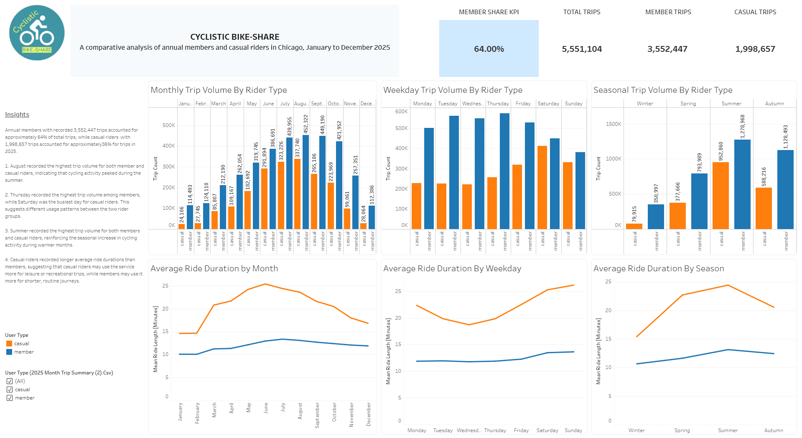

# Cyclistic Bike-Share Analysis – 2025

## Project Overview

This project analyses 12 months of Cyclistic bike-share data to identify differences in how annual members and casual riders use the company's bike-sharing services.

The objective is to generate actionable insights that can help Cyclistic improve customer engagement, optimise operations and convert casual riders into annual members.

## Business Problem

Cyclistic wants to understand how annual members and casual riders use its bike-sharing services differently and how these insights can inform targeted marketing strategies.

## Key Business Questions

1. How do annual members and casual riders differ in total trip volume?
2. Which group records longer mean ride durations?
3. How does riding behaviour vary across the months?
4. Which days of the week have the highest trip activity?
5. How does seasonal demand differ between casual riders and members?
6. How can these insights support membership conversion strategies?

## Tools and Technologies

- **Google BigQuery (SQL):** Data cleaning, transformation and analysis.
- **Tableau Public:** Interactive dashboards and data visualisation.
- **Google Sheet and Google Connected Sheets:** Supporting data preparation and review.
- **GitHub:** Project documentation, SQL scripts and portfolio presentation.

## Analysis Performed

- Monthly trip volume by rider type.
- Weekday trip patterns.
- Seasonal riding patterns.
- Average ride duration by month.
- Average ride duration by weekday.
- Average ride duration by season.

## Key Findings

- August recorded the highest monthly trip volume for both rider categories.
- Thursday was the busiest weekday for members, while Saturday was the busiest for casual riders.
- Summer recorded the highest seasonal trip volume for both groups.
- Casual riders recorded longer average ride durations than members.

## Key Performance Indicators

| Metric | Result |
|---|---:|
| Total Trips | 5,551,104 |
| Member Trips | 3,552,447 |
| Casual Trips | 1,998,657 |
| Member Share | 63.99% |
| Casual Share | 36.01% |

## Interactive Dashboard

**Tableau Public:** 

[View the interactive Tableau dashboard](https://public.tableau.com/views/CyclisticBike-ShareAnalysis2025_17943367132840/CyclisticBike-ShareAnalysis-2025)

## Business Recommendations

- Campaign that emphasizes on the flexibility, freedom and other benefits to encourage casual ridere conversion to memebrs. 
- Introduce targeted weekend membership promotions and dicounts to encourage casual riders to become annual members.
- Increase operational readiness during summer to accommodate higher demand.

## Repository Structure

- `01_Ask/` – Business task and analytical questions.
- `02_Prepare/` – Data sources and descriptions.
- `03_Process/SQL/` – Data validation and cleaning scripts.
- `04_Analyse/SQL/` – SQL analysis and validation scripts.
- `05_Share/` – Dashboard documentation and findings.
- `06_Act/` – Business recommendations.

## Conclusion

This project demonstrates the use of SQL and data visualisation to analyse customer behaviour, identify usage patterns and develop data-driven business recommendations.
